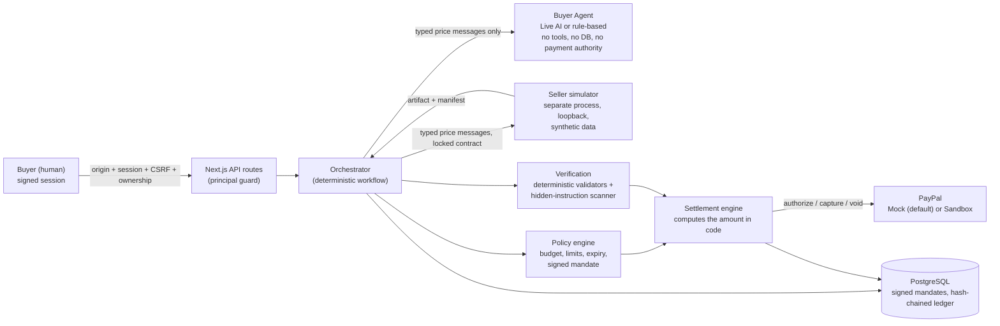

# MANDATE – architecture and trust boundaries (demo build)

Written for: hackathon judges and reviewers who want to see what is trusted, what is not, and where each decision is made.

## One picture

## Who decides what

| Decision | Made by | Never made by |
|---|---|---|
| Spending authority (budget, per-deal cap, counterparties, expiry) | The human, by signing a mandate (Ed25519, digest the human must echo) | An agent |
| The price | Negotiated by the Buyer Agent, **re-validated** by code on every offer: opening at or below the buyer's target, counteroffers only after a seller price, no retreat, at most half the remaining gap per round, never above the mandate ceiling or round limit (`src/domain/negotiation-policy.ts`) | The agent alone |
| Whether the work meets the criteria | Deterministic validators (schema, duplicates, dates, completeness) on the delivered CSV | A model (V1 deals never call one) |
| Whether text in the delivery is hostile | A deterministic scanner; a hit stops the deal for a human | A model |
| How much is paid | The settlement engine, from the locked terms and the verification result | Any human input (no input carries an amount) or any model |
| Moving money | PayPal, called only by the settlement engine | The orchestrator, the agents, the UI |

## Trust boundaries

1. **Browser → API.** HttpOnly signed session cookie, same-origin check, CSRF token on every mutation, per-principal rate limit. The principal is taken from the session and re-checked in the database; request bodies are strict schemas and a body naming a principal, owner or seller is a 400. A foreign deal looks exactly like a missing one (404).
2. **API → runtime.** The runtime (database, PayPal client, agents) is built only after the guard passes, so an unauthenticated request cannot reach a payment operation. A static test fails if a route does not call the guard first.
3. **Orchestrator ↔ Buyer Agent.** (Provider: Google Gemini via `@google/genai` or Groq via `groq-sdk`, one chosen by `LLM_PROVIDER`, server-side only; the key never reaches browser JavaScript. A provider failure blocks that negotiation with the reason; there is no fallback to another brain.) The agent gets a context assembled by trusted code; seller text is sanitized and wrapped as untrusted data; the agent returns one typed intent (`propose`, `counter`, `accept`, `walk_away`). A canary string detects prompt leakage. There is no tool-calling parameter anywhere in the model client.
4. **Orchestrator ↔ Seller simulator.** One fixed loopback URL, strict contracts both ways, size and time limits. The simulator has no database, no PayPal and no mandate, and cannot approve or pay. It is a separate process, **not an operating-system sandbox**; it is a local simulation of a counterparty, with synthetic data.
5. **Delivery intake.** Strict manifest (binds the terms hash, the seller identity and the artifact hash), size limits, immutable storage, a deterministic work budget for scanning.
6. **Settlement ↔ PayPal.** A single gateway (the in-memory mock by default; in Sandbox mode the official PayPal Server SDK, imported only by `src/paypal/sdk-gateway.ts`). The PayPal order must carry this deal's id and locked price or no authorization is made. Writes use stable request ids and are recorded before they are sent; unknown outcomes are resolved by a fresh GET, never by trusting a response or a redirect. In Sandbox mode all writes are locked until the operator authorizes them.

## Honest limits

* PayPal Sandbox: one real end-to-end transaction was completed on 2026-11-09/10 (order, buyer approval, authorization, verified delivery, capture of 20.00 USD, reconciled; `docs/submission/PAYPAL-EVIDENCE.md`). Settlement in that run followed the expired-challenge-window rule; no explicit buyer acceptance was recorded. Void, refund, partial capture and webhooks have not been exercised against real PayPal; results shown in the mock are simulations.
* A real model (Groq `openai/gpt-oss-20b`) negotiated in three real runs (7 requests) against the simulated seller with mock PayPal (`docs/submission/GROQ-EVIDENCE.md`); the latest negotiation prompt is validated offline only. The real-AI negotiation and the real PayPal payment were separate runs. When no model is configured the Buyer Agent runs its deterministic rule and the UI says so.
* The seller is a simulator; there is no real counterparty identity. Production hardening (distributed rate limits, webhook verification, deployment, monitoring) is not done. See `docs/qa/eod-release-readiness-report.md`.
